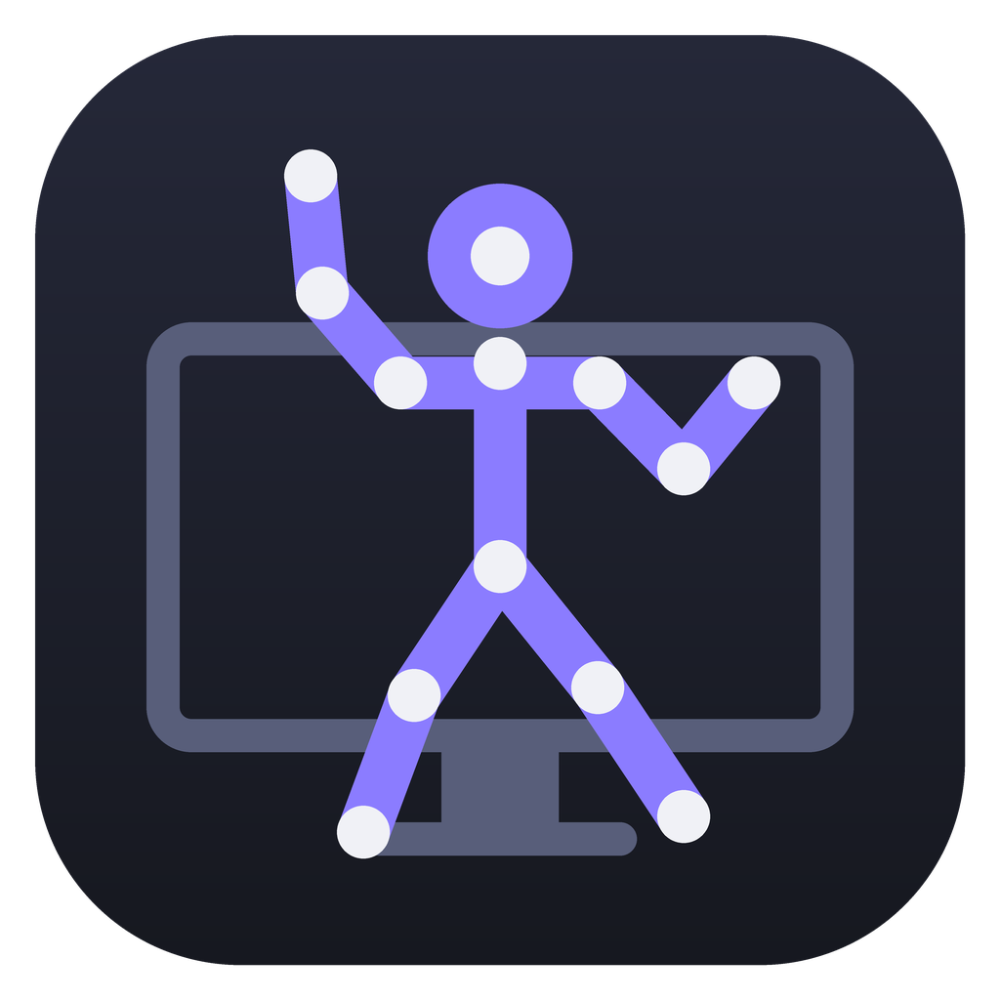
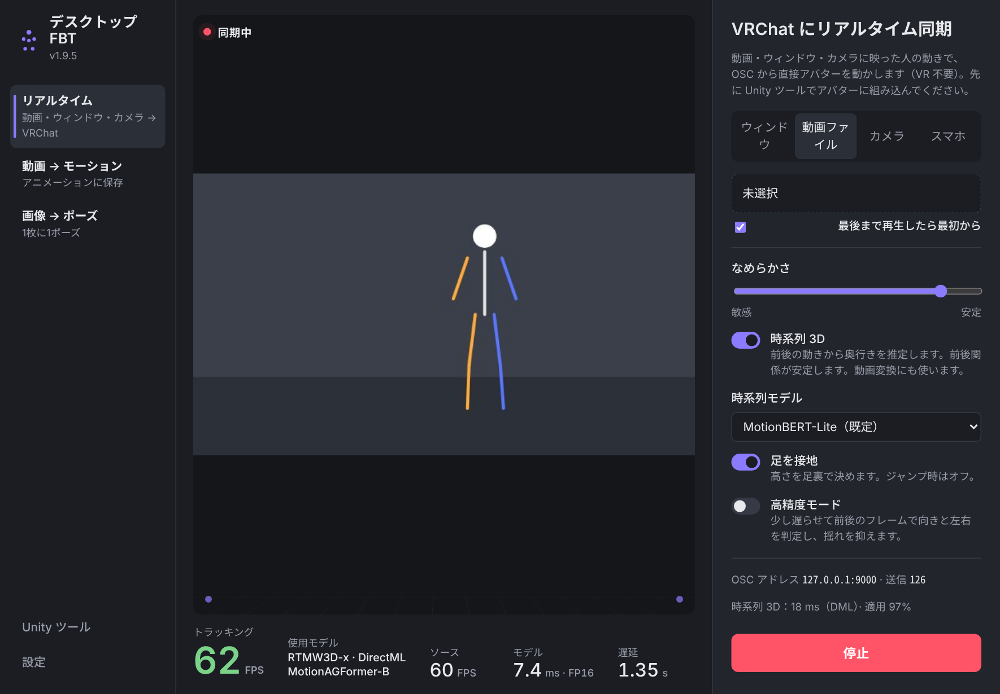

# デスクトップFBT

**動画・ウィンドウ・カメラに映った人の動きで、VRChat のアバターを全身で動かす** 
VR 機器もトラッカーも要りません。Windows の PC だけで動きます。

**日本語** ｜ [English](README_EN.md) ｜ [繁體中文](README_ZH.md)

## できること

| | |
|---|---|
| **リアルタイム同期** | ブラウザなどのウィンドウ、動画ファイル、Web カメラ、スマホ（QR コードで接続）の映像から人の動きを読み取り、OSC で VRChat のアバターを動かします。デスクトップモードで使えます。 |
| **動画 → モーション** | 動画を丸ごと解析して、Unity の Humanoid アニメーション（`.anim`）、`.unitypackage`、BVH に保存します。 |
| **画像 → ポーズ** | 写真 1 枚を 1 つのポーズとして保存します。 |
| **モーションライブラリ** | 変換したモーション・ポーズや、手持ちの Humanoid アニメーション（.anim、テキスト形式）を、クリック 1 つで OSC でアバターに再生します。カメラも GPU も不要です。 |
| **高精度モード（GEM-X）** | NVIDIA GEM-X で、世界座標の全身の動き（向き・移動・足運び）を直接推定します（動画と画像）。 |
| **Unity ツール付き** | アバターに同期用のパラメーターとレイヤーをワンクリックで追加します。 |

## はじめかた

1. **[Releases](https://github.com/IROHAuwu/DesktopFBT/releases/latest) から zip をダウンロード**して解凍し、`DesktopFBT.exe` を実行します。インストールは不要です。
   - 初回起動時にポーズ推定モデル（約 470 MB）を自動でダウンロードします。
   - 「Windows によって PC が保護されました」と出たら、**詳細情報 → 実行** を選んでください（署名のない個人製アプリのためです）。
   - 起動時に「Failed to resolve Python.Runtime.Loader.Initialize」というエラーが出る場合は、v1.13.2 以降を使うか、ダウンロードした zip を右クリック → **プロパティ → 「許可する」** にチェックを入れてから展開し直してください（Windows がダウンロードしたファイルをブロックしています）。
2. **アバターを準備**します。アプリの「Unity ツール」からパッケージを Unity に入れ、メニュー **Tools → デスクトップFBT → Desktop Mode (デスクトップモード)** でアバターを選んで「追加」し、アップロードします。
3. **VRChat で OSC を有効**にします（アクションメニュー → Options → OSC → Enabled）。
4. アプリの「リアルタイム」で映像のソースを選び、**開始**を押します。VRChat のメニューで「デスクトップFBT」をオンにすると、アバターが動きます。

## 高精度モード（GEM-X）

「動画 → モーション」「画像 → ポーズ」の解析方法で **GEM-X** を選ぶと使えます。

- モデル（約 3.5 GB）は初回に自動でダウンロードされます。途中で止めても、次回は続きから再開します。
- 固定カメラで、映っている人が 1 人の映像に向いています。
- グラフィックボードが必要です。RX 7900 XT では 1 フレームあたり約 70 ミリ秒（30fps の動画なら長さの約 3 倍の時間）でした。

## 動作環境

- Windows 10 / 11（64 ビット）
- グラフィックボード推奨：AMD / NVIDIA / Intel（DirectML）。AMD では MIGraphX も利用できる場合、速いほうを自動で選びます。
- VRChat（OSC を使用）。アバターの組み込みには Unity と VRChat の Avatar SDK が必要です。

## うまく動かないとき

- **アバターが動かない**：VRChat の OSC が有効か、アバターを Unity ツールで「追加」してからアップロードしたか、VRChat のメニューで「デスクトップFBT」がオンになっているかを確認してください。
- **動きがカクつく・遅れる**：設定で「一度に推論するフレーム数」を増やすか、「時系列 3D」をオフにしてみてください。
- **手がアバターの頭にめり込む**：設定の「頭の大きさ」を大きくしてください（頭の大きいアバターは広めに）。
- **それでも解決しない**：アプリのフォルダにある `log.txt` を添えて [Issues](https://github.com/IROHAuwu/DesktopFBT/issues) に書いてください。

## ソースから動かす

Python 3.11 が必要です。`run_from_source.bat` で起動、`build.bat` で EXE を作成できます。

## クレジットとライセンス

デスクトップFBT は無料で使えます。ソースコードは [Apache License 2.0](LICENSE) で公開しています。

使用している主なモデルとライブラリ：

- [RTMW3D / YOLOX](https://github.com/open-mmlab/mmpose)（MMPose）— ポーズ推定
- [MotionBERT](https://github.com/Walter0807/MotionBERT)、[MotionAGFormer](https://github.com/TaatiTeam/MotionAGFormer) — 時系列 3D（Apache-2.0）
- [NVIDIA GEM-X](https://github.com/NVlabs/GEM-X) と [SOMA-X](https://github.com/NVlabs/SOMA-X) — 高精度モード（コード Apache-2.0、モデルは NVIDIA Open Model License）
- [ONNX Runtime](https://onnxruntime.ai/)、[rtmlib](https://github.com/Tau-J/rtmlib)、[pywebview](https://pywebview.flowrl.com/) ほか

同梱している第三者ソフトウェアのライセンス全文は [THIRD_PARTY_NOTICES](THIRD_PARTY_NOTICES/INDEX.md) にあります。

デスクトップFBT は個人が作った非公式のツールで、VRChat Inc. とは関係ありません。
