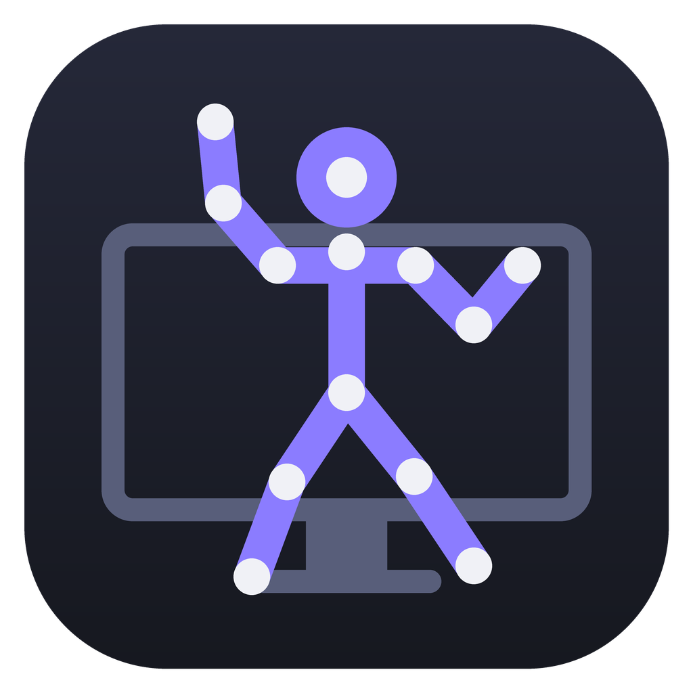
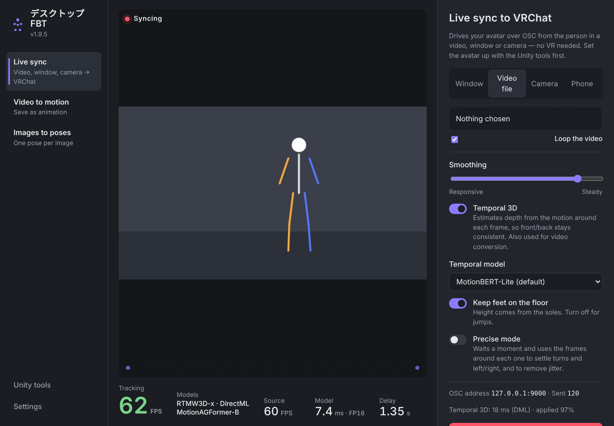

# デスクトップFBT (DesktopFBT)

**Drive your VRChat avatar's whole body from a person in a video, a window or a camera** 
No headset and no trackers. All you need is a Windows PC.

[日本語](README.md) ｜ **English** ｜ [繁體中文](README_ZH.md)

## What it does

| | |
|---|---|
| **Live sync** | Reads a person's motion from a window (a browser, for example), a video file, a webcam or your phone (connect with a QR code) and drives your VRChat avatar over OSC. Works in VRChat desktop mode. |
| **Video → motion** | Analyses a whole video and saves it as a Unity Humanoid animation (`.anim`), a `.unitypackage` and BVH. |
| **Image → pose** | Saves one pose per photo. |
| **Motion library** | Play converted motions and poses, or your own Humanoid animations (.anim, text format), on the avatar over OSC with one click. No camera or GPU needed. |
| **High-accuracy mode (GEM-X)** | Uses NVIDIA GEM-X to estimate world-space full-body motion (facing, travel, footwork) directly, for videos and images. |
| **Unity tool included** | Adds the sync parameters and layers to your avatar in one click. |

## Getting started

1. **Download the zip from [Releases](https://github.com/IROHAuwu/DesktopFBT/releases/latest)**, unzip it and run `DesktopFBT.exe`. There is nothing to install.
   - On first start it downloads the pose models (about 470 MB).
   - If Windows shows "Windows protected your PC", choose **More info → Run anyway** (the app is an unsigned personal project).
   - If it fails at startup with "Failed to resolve Python.Runtime.Loader.Initialize", use v1.13.2 or later, or right-click the downloaded zip → **Properties → Unblock**, then extract it again (Windows is blocking the downloaded files).
2. **Prepare your avatar.** Use "Unity tools" in the app to bring the package into Unity, open **Tools → デスクトップFBT → Desktop Mode (デスクトップモード)**, pick your avatar, press "Add" and upload it. The tool window can be switched to English at the top.
3. **Enable OSC in VRChat** (Action Menu → Options → OSC → Enabled).
4. On the "Live sync" page choose a video source and press **Start**. Turn on "デスクトップFBT" in your VRChat menu and the avatar starts moving.

## High-accuracy mode (GEM-X)

Choose **GEM-X** as the method on the "Video to motion" or "Images to poses" page.

- The models (about 3.5 GB) are downloaded the first time. You can stop the download and it resumes later.
- Best for footage from a still camera with one person in view.
- Needs a graphics card. On an RX 7900 XT it took about 70 ms per frame (roughly three times the length of a 30 fps video).

## Requirements

- Windows 10 / 11 (64-bit)
- A graphics card is recommended: AMD, NVIDIA or Intel (DirectML). On AMD cards MIGraphX is also tried and the faster one is used.
- VRChat (uses OSC). Setting up the avatar needs Unity and the VRChat Avatar SDK.

## Troubleshooting

- **The avatar doesn't move**: check that OSC is enabled in VRChat, that the avatar was uploaded after pressing "Add" in the Unity tool, and that "デスクトップFBT" is turned on in the VRChat menu.
- **Motion stutters or lags**: raise "Frames per inference" in Settings, or turn off "Temporal 3D".
- **Hands clip into the avatar's head**: raise "Head size" in Settings (avatars with large heads need more room).
- **Still stuck**: open an [issue](https://github.com/IROHAuwu/DesktopFBT/issues) and attach `log.txt` from the app folder.

## Running from source

Needs Python 3.11. `run_from_source.bat` starts the app and `build.bat` builds the EXE.

## Credits and licenses

デスクトップFBT is free to use. The source code is released under the [Apache License 2.0](LICENSE).

Main models and libraries:

- [RTMW3D / YOLOX](https://github.com/open-mmlab/mmpose) (MMPose) for pose estimation
- [MotionBERT](https://github.com/Walter0807/MotionBERT) and [MotionAGFormer](https://github.com/TaatiTeam/MotionAGFormer) for temporal 3D (Apache-2.0)
- [NVIDIA GEM-X](https://github.com/NVlabs/GEM-X) and [SOMA-X](https://github.com/NVlabs/SOMA-X) for the high-accuracy mode (code Apache-2.0, models under the NVIDIA Open Model License)
- [ONNX Runtime](https://onnxruntime.ai/), [rtmlib](https://github.com/Tau-J/rtmlib), [pywebview](https://pywebview.flowrl.com/) and others

Full license texts of the bundled third-party software are in [THIRD_PARTY_NOTICES](THIRD_PARTY_NOTICES/INDEX.md).

デスクトップFBT is an unofficial tool made by an individual and is not affiliated with VRChat Inc.
