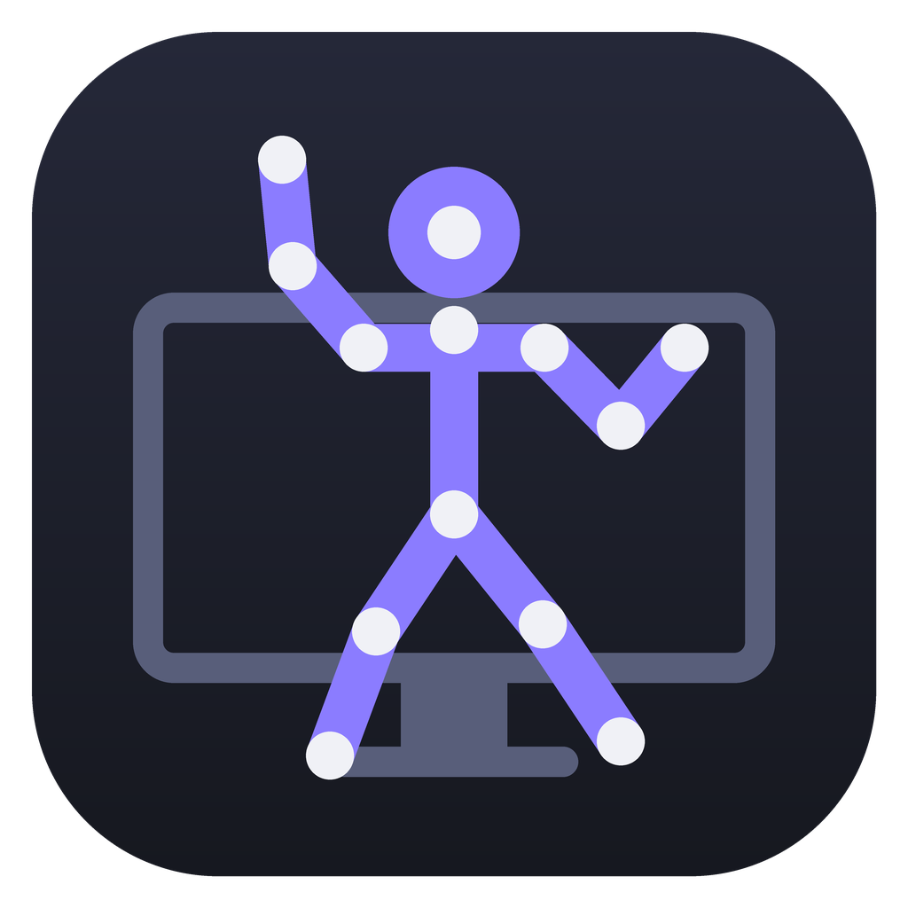
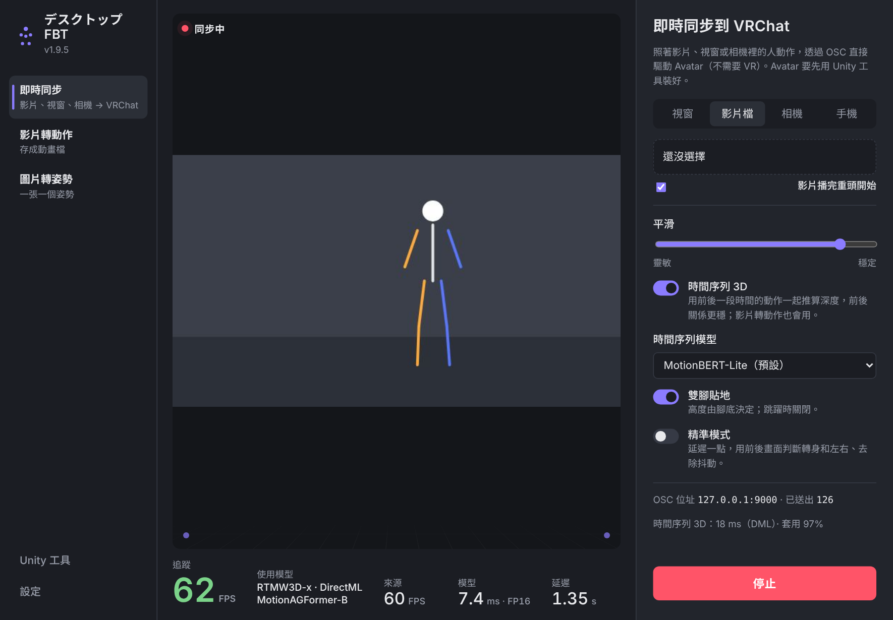

# デスクトップFBT（DesktopFBT）

**用影片、視窗或相機裡的人的動作，帶動 VRChat Avatar 的全身** 
不需要 VR 裝置，也不需要追蹤器，只要一台 Windows 電腦。

[日本語](README.md) ｜ [English](README_EN.md) ｜ **繁體中文**

## 功能

| | |
|---|---|
| **即時同步** | 從視窗（例如瀏覽器）、影片檔、網路攝影機或手機（掃 QR code 連線）的畫面讀出人的動作，用 OSC 帶動 VRChat 的 Avatar。在桌面模式就能用。 |
| **影片轉動作** | 分析整部影片，存成 Unity 的 Humanoid 動畫（`.anim`）、`.unitypackage` 和 BVH。 |
| **圖片轉姿勢** | 每張照片存成一個姿勢。 |
| **動作庫** | 轉換好的動作、姿勢，或自己的 Humanoid 動畫（.anim，文字格式），點一下就透過 OSC 播到 Avatar，不用相機也不用顯示卡。 |
| **高精度模式（GEM-X）** | 用 NVIDIA GEM-X 直接推算世界座標的全身動作（朝向、移動、腳步），影片和圖片都能用。 |
| **附 Unity 工具** | 一鍵幫 Avatar 加上同步用的參數和圖層。 |

## 開始使用

1. **到 [Releases](https://github.com/IROHAuwu/DesktopFBT/releases/latest) 下載 zip**，解壓縮後執行 `DesktopFBT.exe`，不用安裝。
   - 第一次啟動會自動下載姿勢模型（約 470 MB）。
   - 出現「Windows 已保護您的電腦」時，選 **其他資訊 → 仍要執行**（這是沒有簽章的個人作品）。
   - 啟動時出現「Failed to resolve Python.Runtime.Loader.Initialize」：請用 v1.13.2 以上，或對下載的 zip 按右鍵 → **內容 → 解除封鎖** 後重新解壓縮（Windows 封鎖了下載的檔案）。
2. **準備 Avatar**。用程式裡的「Unity 工具」把套件放進 Unity，從選單 **Tools → デスクトップFBT → Desktop Mode (デスクトップモード)** 選 Avatar、按「追加」，然後上傳。
3. **在 VRChat 開啟 OSC**（動作選單 → Options → OSC → Enabled）。
4. 在程式的「即時同步」選好畫面來源，按 **開始**。在 VRChat 的選單打開「デスクトップFBT」，Avatar 就會動起來。

## 高精度模式（GEM-X）

在「影片轉動作」或「圖片轉姿勢」的分析方式選 **GEM-X**。

- 模型（約 3.5 GB）第一次使用時自動下載，可以中途停止，下次接著下載。
- 適合相機固定、畫面裡只有一個人的影片。
- 需要顯示卡。在 RX 7900 XT 上每幀約 70 毫秒（30fps 的影片大約要花影片長度的三倍時間）。

## 系統需求

- Windows 10 / 11（64 位元）
- 建議有顯示卡：AMD、NVIDIA、Intel 都可以（DirectML）。AMD 顯示卡會另外試 MIGraphX，自動用比較快的那個。
- VRChat（使用 OSC）。設定 Avatar 需要 Unity 和 VRChat 的 Avatar SDK。

## 遇到問題

- **Avatar 不會動**：確認 VRChat 的 OSC 已開啟、Avatar 是在 Unity 工具按過「追加」之後才上傳的、VRChat 選單裡的「デスクトップFBT」已打開。
- **動作卡頓或延遲**：在設定調高「一次推論幾幀」，或關掉「時間序列 3D」。
- **手穿進 Avatar 的頭**：到設定把「頭的大小」調大（頭比較大的 Avatar 需要多留一點空間）。
- **還是不行**：到 [Issues](https://github.com/IROHAuwu/DesktopFBT/issues) 回報，並附上程式資料夾裡的 `log.txt`。

## 從原始碼執行

需要 Python 3.11。`run_from_source.bat` 啟動程式，`build.bat` 建置 EXE。

## 致謝與授權

デスクトップFBT 可以免費使用。原始碼以 [Apache License 2.0](LICENSE) 公開。

使用的主要模型與函式庫：

- [RTMW3D／YOLOX](https://github.com/open-mmlab/mmpose)（MMPose）：姿勢估計
- [MotionBERT](https://github.com/Walter0807/MotionBERT)、[MotionAGFormer](https://github.com/TaatiTeam/MotionAGFormer)：時間序列 3D（Apache-2.0）
- [NVIDIA GEM-X](https://github.com/NVlabs/GEM-X) 與 [SOMA-X](https://github.com/NVlabs/SOMA-X)：高精度模式（程式 Apache-2.0，模型為 NVIDIA Open Model License）
- [ONNX Runtime](https://onnxruntime.ai/)、[rtmlib](https://github.com/Tau-J/rtmlib)、[pywebview](https://pywebview.flowrl.com/) 等

內附的第三方軟體授權全文在 [THIRD_PARTY_NOTICES](THIRD_PARTY_NOTICES/INDEX.md)。

デスクトップFBT 是個人製作的非官方工具，和 VRChat Inc. 沒有關係。
